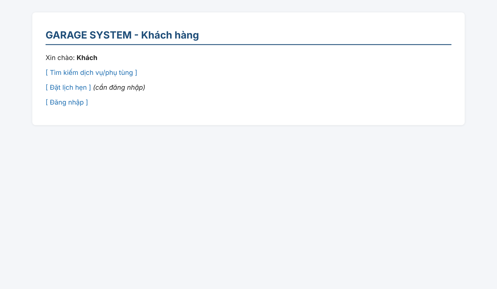
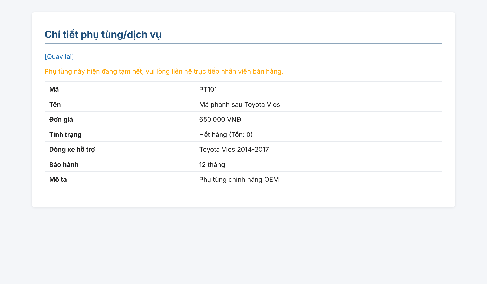
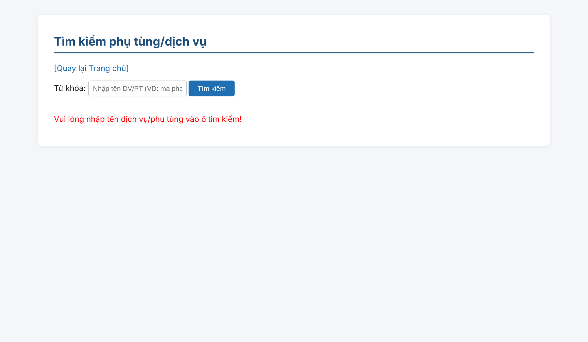
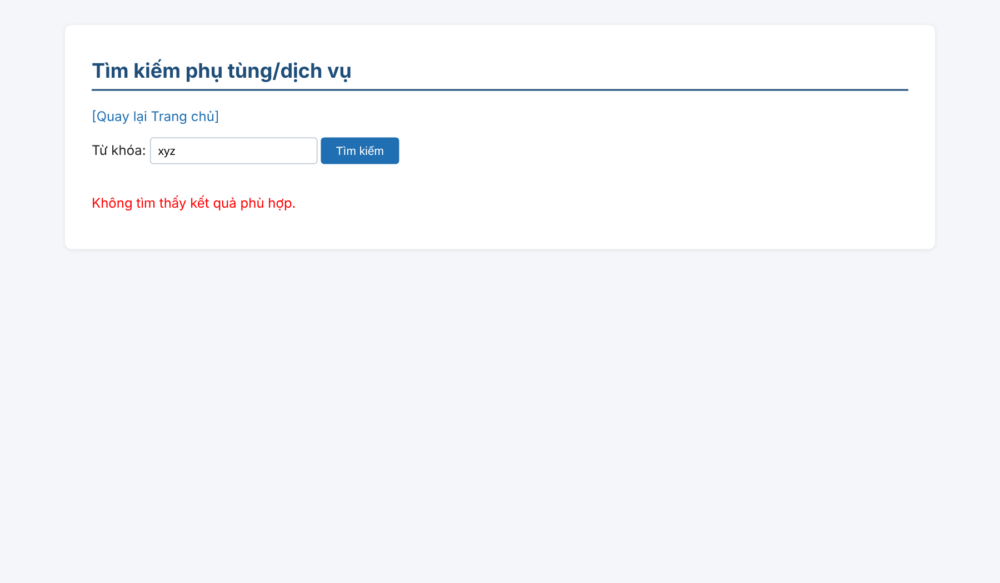
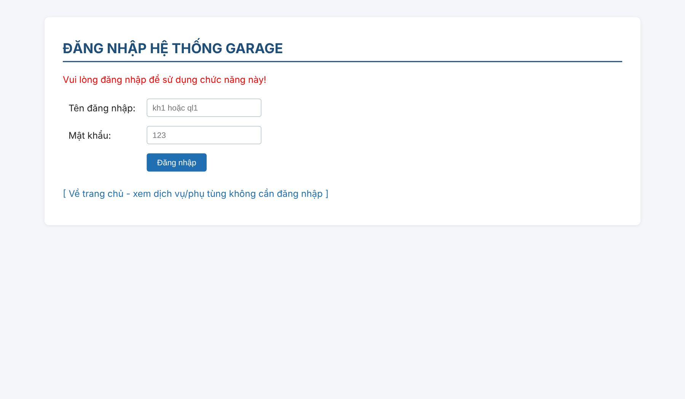
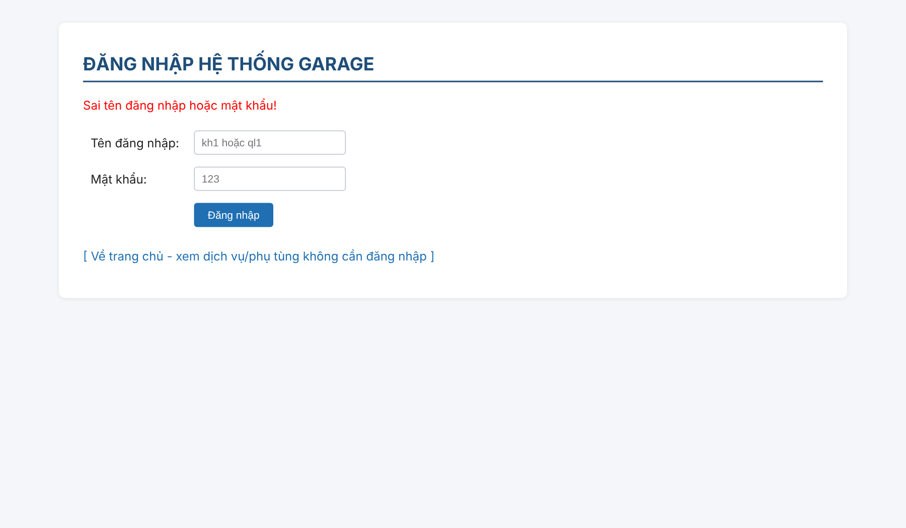
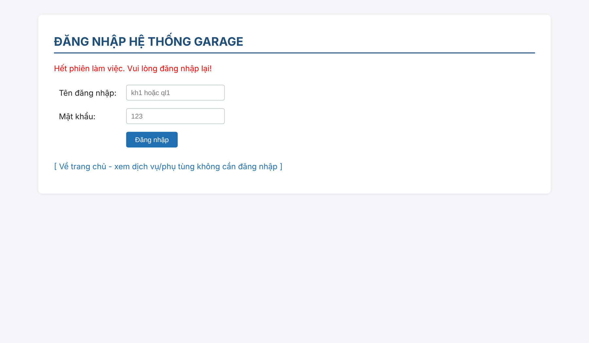
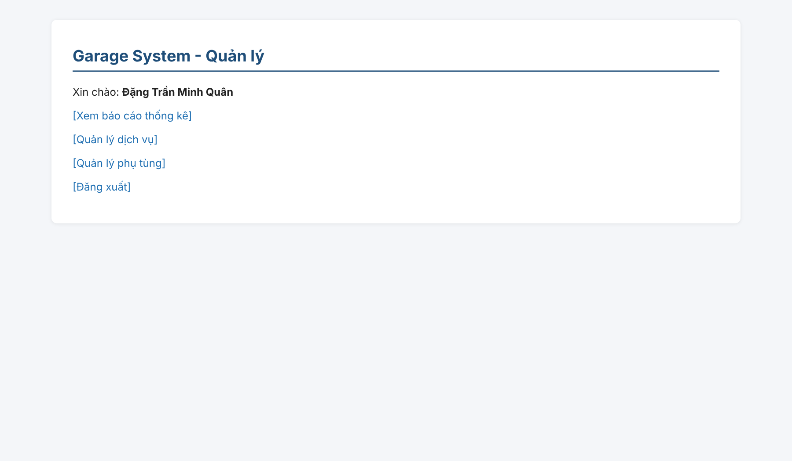
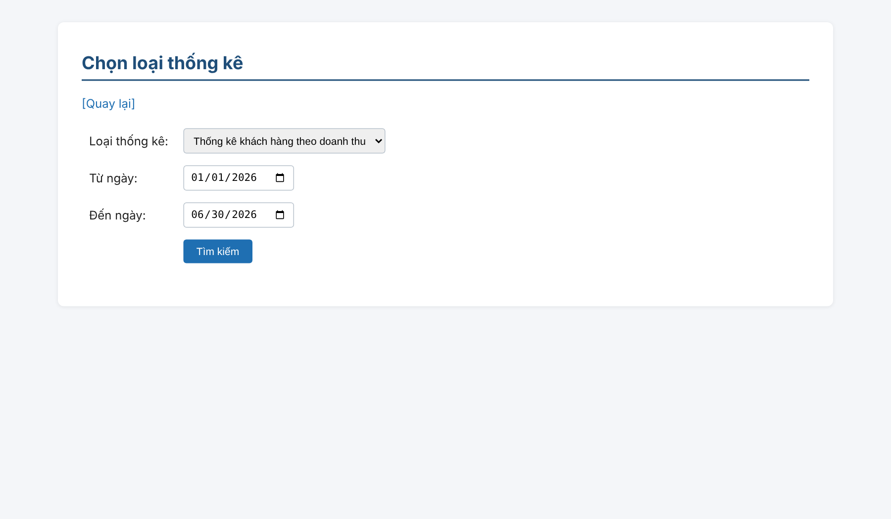
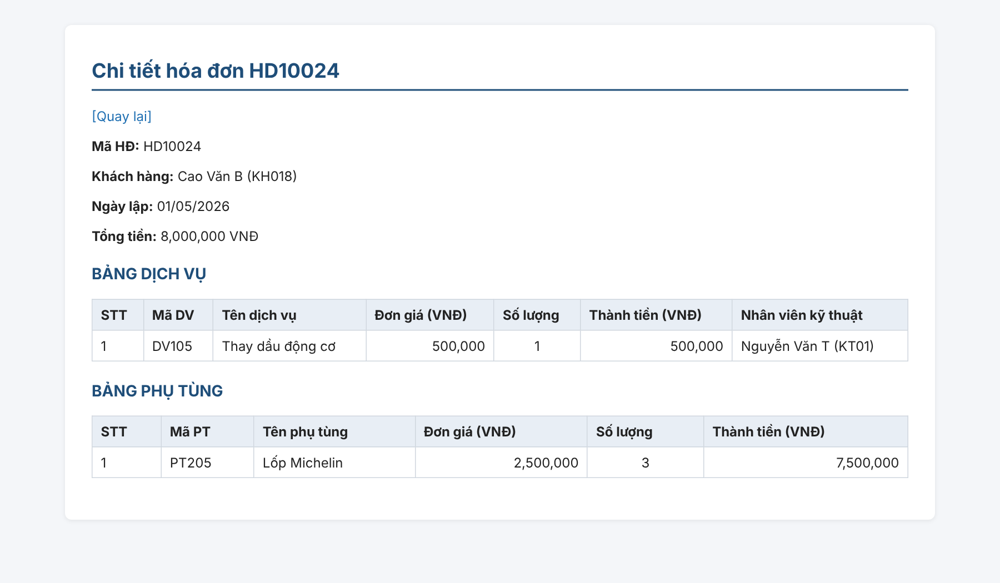

# Garage Management System 6

Hệ thống quản lý gara ô tô xây dựng bằng **Java Web (JSP + DAO) + MySQL**, chạy trên **Apache Tomcat 10.1**.
Đồ án học phần **Phân tích và thiết kế hệ thống thông tin** – Học viện Công nghệ Bưu chính Viễn thông (PTIT), **Đề 30**.

| | |
|---|---|
| Sinh viên | Đặng Trần Minh Quân – B23DCVT346 – E23CNPM01 – Nhóm 01 |
| Giảng viên hướng dẫn | Đỗ Thị Bích Ngọc |
| Công nghệ | Java 17 · JSP (Jakarta EE) · JDBC · MySQL 8 · Apache Tomcat 10.1 · Maven |

---

## Mục lục

1. [Giới thiệu](#1-giới-thiệu)
2. [Chức năng đã cài đặt](#2-chức-năng-đã-cài-đặt)
3. [Kiến trúc hệ thống](#3-kiến-trúc-hệ-thống)
4. [Cơ sở dữ liệu](#4-cơ-sở-dữ-liệu)
5. [Cài đặt và chạy](#5-cài-đặt-và-chạy)
6. [Demo giao diện](#6-demo-giao-diện)
7. [Tài liệu phân tích – thiết kế (UML)](#7-tài-liệu-phân-tích--thiết-kế-uml)
8. [Cấu trúc thư mục](#8-cấu-trúc-thư-mục)
9. [Phạm vi và hạn chế](#9-phạm-vi-và-hạn-chế)

---

## 1. Giới thiệu

Hệ thống hỗ trợ một gara bảo dưỡng ô tô quản lý dịch vụ, phụ tùng, khách hàng, phương tiện, tiếp nhận xe, hóa đơn và nhập kho. Có 4 nhóm người dùng: **khách hàng, nhân viên bán hàng, nhân viên kho và nhân viên quản lý**.

Theo yêu cầu đề bài, dự án cài đặt chi tiết **2 module**:

| Module | Người dùng | Mô tả |
|---|---|---|
| **1. Customer searches for service information** | Khách hàng (không cần đăng nhập) | Tìm dịch vụ/phụ tùng theo tên, xem chi tiết giá, tình trạng, dòng xe hỗ trợ, bảo hành |
| **2. Management staff views customer statistics** | Nhân viên quản lý (bắt buộc đăng nhập) | Thống kê khách hàng theo doanh thu trong một khoảng thời gian → xem hóa đơn của khách → xem chi tiết hóa đơn |

## 2. Chức năng đã cài đặt

**Module 1 – Tìm kiếm dịch vụ/phụ tùng**
- Trang chủ khách hàng mở được khi chưa đăng nhập (khách vãng lai).
- Tìm theo tên có chứa từ khóa, không phân biệt hoa thường hay có dấu/không dấu. Kết quả gộp cả phụ tùng và dịch vụ.
- Xem chi tiết: mã, tên, đơn giá, tình trạng/tồn kho, dòng xe hỗ trợ, bảo hành, mô tả.
- Xử lý ngoại lệ: ô tìm kiếm trống, không tìm thấy, phụ tùng hết hàng, dịch vụ ngừng cung cấp.

**Module 2 – Thống kê khách hàng theo doanh thu**
- Đăng nhập. Các trang quản lý kiểm tra phiên làm việc (session); chưa đăng nhập thì chuyển về trang đăng nhập.
- Chọn khoảng thời gian, xem danh sách khách hàng xếp theo tổng doanh thu giảm dần.
- Chọn khách hàng để xem danh sách hóa đơn trong kỳ, chọn hóa đơn để xem chi tiết (bảng dịch vụ kèm thợ thực hiện, bảng phụ tùng).
- Xử lý ngoại lệ: bỏ trống ngày, ngày không tồn tại, ngày bắt đầu lớn hơn ngày kết thúc, kỳ không có dữ liệu.

**Dùng chung:** đăng nhập/đăng xuất theo vai trò (CUSTOMER, MANAGEMENT). Các chức năng ngoài phạm vi (đặt lịch, quản lý dịch vụ…) hiển thị thông báo *"Chức năng đang phát triển"*.

## 3. Kiến trúc hệ thống

Ứng dụng web 3 tầng theo mô hình **JSP – DAO – Model**:

```
Trình duyệt ──HTTP──► Tomcat 10.1 ──JDBC──► MySQL 8 (garage_db6)
                       │
                       ├─ view  (JSP)   : giao diện + điều hướng
                       ├─ dao   (Java)  : truy vấn CSDL, đóng gói thực thể
                       └─ model (Java)  : lớp thực thể
```

- **Quy ước đặt tên trang:** `gd…` là trang **giao diện** (có hiển thị). `do…` là trang **xử lý** (nhận dữ liệu, gọi DAO rồi chuyển trang).
- **Hậu tố `6`** trên mọi lớp, bảng và trang là quy ước đánh số của đề.
- `DAO6` là lớp cha giữ kết nối JDBC; các DAO con kế thừa để dùng chung.

| Tầng | Thành phần |
|---|---|
| view / thanhvien | `gdDangNhap6.jsp`, `doDangNhap6.jsp`, `doDangXuat6.jsp` |
| view / khachhang | `gdChinhKH6.jsp`, `gdTimKiem6.jsp`, `gdChiTiet6.jsp` |
| view / quanly | `gdChinhQL6.jsp`, `gdChonThongKe6.jsp`, `gdKetQuaThongKe6.jsp`, `gdDSHoaDon6.jsp`, `gdChiTietHoaDon6.jsp` |
| dao | `DAO6`, `SystemMemberDAO6`, `ServiceDAO6`, `SparePartDAO6`, `CustomerStatisticDAO6`, `InvoiceDAO6` |
| model | `SystemMember6`, `Customer6`, `Staff6`, `ManagementStaff6`, `TechnicalStaff6`, `Service6`, `SparePart6`, `Invoice6`, `ServiceDetail6`, `SparePartDetail6`, `CustomerStatistic6` |


## 4. Cơ sở dữ liệu

Schema `garage_db6` gồm **18 bảng**. Bảng kế thừa được tách theo lớp: `tblSystemMember6` → `tblCustomer6`, `tblStaff6` → 4 bảng nhân viên. File `database/garage_db6.sql` tạo toàn bộ bảng và dữ liệu mẫu khớp với kịch bản trong báo cáo.

Doanh thu của khách hàng được tính theo chuỗi quan hệ:

```
tblCustomer6 → tblVehicle6 → tblReception6 → tblInvoice6   (SUM totalAmount, GROUP BY khách hàng)
```


## 5. Cài đặt và chạy

### 5.1. Yêu cầu

| Phần mềm | Phiên bản |
|---|---|
| JDK | 17 trở lên |
| MySQL Server + MySQL Workbench | 8.x |
| Apache Tomcat | **10.1.x** (không dùng Tomcat 9 vì dự án dùng chuẩn Jakarta) |
| Apache Maven | 3.8 trở lên |
| IDE (tùy chọn) | VS Code + *Extension Pack for Java* (+ *Community Server Connectors*) |

### 5.2. Tạo CSDL

1. Mở **MySQL Workbench**, kết nối tài khoản `root`.
2. Vào **File → Open SQL Script…**, chọn `database/garage_db6.sql`, rồi bấm ⚡ **Execute**.
3. Kiểm tra bằng câu lệnh `SELECT * FROM garage_db6.tblSparePart6;`. Tiếng Việt hiển thị đúng là đã thành công.

### 5.3. Cấu hình kết nối

Mở `src/main/java/dao/DAO6.java` và sửa mật khẩu MySQL của máy bạn:

```java
con = DriverManager.getConnection(dbUrl, "root", "root"); // tham số thứ 3 = mật khẩu MySQL
```

Driver `mysql-connector-j` đã khai báo trong `pom.xml`, Maven tự tải về và đóng vào file `.war`.

### 5.4. Build và chạy

```bat
git clone https://github.com/IvorDang/Garage_Management_6.git
cd Garage_Management_6
mvn clean package
copy target\GarageManagement.war C:\tomcat10\webapps\
C:\tomcat10\bin\startup.bat
```

Mở trình duyệt tại **http://localhost:8080/GarageManagement/**

> Chạy trong VS Code: ở panel **SERVERS** (Community Server Connectors), thêm Tomcat tại `C:\tomcat10`. Sau đó chuột phải chọn **Add Deployment**, trỏ tới `target/GarageManagement.war`, rồi chọn **Start Server**.

### 5.5. Tài khoản demo

| Vai trò | Tên đăng nhập | Mật khẩu | Ghi chú |
|---|---|---|---|
| Nhân viên quản lý | `ql1` | `123` | Đặng Trần Minh Quân |
| Khách hàng | `kh1` | `123` | Cao Văn B (KH018) |
| Khách vãng lai | — | — | Không cần tài khoản để tìm kiếm |

### 5.6. Lỗi thường gặp

| Lỗi | Cách sửa |
|---|---|
| `Access denied for user 'root'` | Sai mật khẩu trong `DAO6.java` |
| `Communications link failure` | MySQL chưa chạy: mở `services.msc` rồi Start **MySQL80** |
| `ClassNotFoundException: com.mysql.cj.jdbc.Driver` | Chưa build bằng Maven (hoặc chưa có jar trong `WEB-INF/lib`) |
| 404 toàn bộ / lỗi `javax.servlet` | Đang dùng Tomcat 9: đổi sang Tomcat 10.1 |
| Tiếng Việt lỗi font | Chạy lại toàn bộ file SQL (đầu file đã có `SET NAMES utf8mb4`) |

## 6. Demo giao diện

### Module 1 – Khách hàng tìm kiếm dịch vụ/phụ tùng

| Trang chủ khách hàng (chưa đăng nhập) | Kết quả tìm "má phanh" |
|---|---|
|  |  |

| Chi tiết phụ tùng PT100 | Phụ tùng hết hàng (PT101) |
|---|---|
|  |  |

| Dịch vụ ngừng cung cấp (DV600) | Ô tìm kiếm trống | Không tìm thấy |
|---|---|---|
|  |  |  |

### Đăng nhập

| Đặt lịch khi chưa đăng nhập | Sai mật khẩu | Truy cập trang quản lý khi chưa đăng nhập |
|---|---|---|
|  |  |  |

### Module 2 – Quản lý xem thống kê khách hàng theo doanh thu

| Trang chủ quản lý | Chọn loại thống kê và thời gian |
|---|---|
|  |  |

| Thống kê 01/01/2026 – 30/06/2026 | Danh sách hóa đơn của Cao Văn B |
|---|---|
|  |  |

| Chi tiết hóa đơn HD10024 | Ngày bắt đầu lớn hơn ngày kết thúc | Kỳ không có dữ liệu |
|---|---|---|
|  |  |  |

**Kịch bản demo nhanh**

1. Mở trang chủ, bấm *Tìm kiếm dịch vụ/phụ tùng*, nhập **má phanh**. Kết quả: PT100, PT101, DV200. Bấm *Xem chi tiết* PT100.
2. Bấm *Đặt lịch hẹn*, hệ thống yêu cầu đăng nhập. Đăng nhập **ql1 / 123**.
3. Vào *Xem báo cáo thống kê*, chọn **01/01/2026 – 30/06/2026** rồi bấm *Tìm kiếm*. Kết quả: Đặng Văn L 36.000.000, Cao Văn B 15.500.000, Nguyễn Thị H 1.200.000.
4. Bấm **Cao Văn B** để thấy HD10024 và HD10067. Bấm **HD10024** để xem chi tiết: thay dầu động cơ (thợ Nguyễn Văn T), 3 lốp Michelin, tổng 8.000.000.

## 7. Tài liệu phân tích – thiết kế (UML)

Mã nguồn PlantUML (`.puml`) và ảnh của 20 biểu đồ nằm trong [`docs/uml`](docs/uml). Bản in mỗi biểu đồ một trang A4: [`docs/uml/UML_TongHop_A4.pdf`](docs/uml/UML_TongHop_A4.pdf).

| Pha | Biểu đồ |
|---|---|
| Đặc tả | Use case tổng quan, Use case Module 1, Use case Module 2 |
| Phân tích | Lớp thực thể, lớp phân tích Module 1/2, trạng thái Module 1/2, giao tiếp Module 1/2 |
| Thiết kế | Lớp thực thể (thiết kế), CSDL, lớp thiết kế Module 1/2, sơ đồ hành vi Module 1/2, tuần tự Module 1/2, Package, Deployment |

| Use case tổng quan | Lớp thiết kế Module 2 |
|---|---|
|  |  |

Xuất lại ảnh từ mã nguồn: cài extension **PlantUML** trong VS Code, hoặc chạy `java -jar plantuml.jar -Sdpi=220 docs/uml/*.puml`.

## 8. Cấu trúc thư mục

```
Garage_Management_6/
├── pom.xml                         # Maven: đóng gói WAR, driver mysql-connector-j
├── database/
│   └── garage_db6.sql              # tạo 18 bảng + dữ liệu mẫu
├── docs/
│   ├── screenshots/                # ảnh demo giao diện
│   └── uml/                        # 20 biểu đồ PlantUML (.puml + .png) + bản PDF A4
└── src/main/
    ├── java/
    │   ├── dao/                    # DAO6 + các lớp truy xuất dữ liệu
    │   └── model/                  # lớp thực thể
    └── webapp/
        ├── index.jsp               # chuyển tới trang chủ khách hàng
        ├── css/style.css
        ├── WEB-INF/web.xml
        ├── thanhvien/              # đăng nhập, đăng xuất
        ├── khachhang/              # Module 1
        └── quanly/                 # Module 2
```

## 9. Phạm vi và hạn chế

- Chỉ cài đặt 2 module theo đề. Các gói `banhang`, `kho` và chức năng đặt lịch thuộc thiết kế tổng thể, chưa cài đặt.
- Dự án chạy local phục vụ học tập: mật khẩu lưu dạng thường (có dùng `PreparedStatement` để chống SQL injection). Khi triển khai thật cần băm mật khẩu (ví dụ BCrypt) và dùng connection pool.
- Giao diện tối ưu cho trình duyệt trên máy tính; điện thoại vẫn truy cập được qua cùng địa chỉ web.

---

© 2026 Đặng Trần Minh Quân – PTIT. Dự án phục vụ mục đích học tập.
